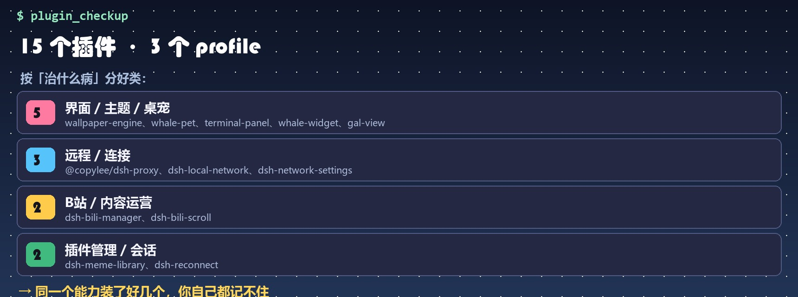
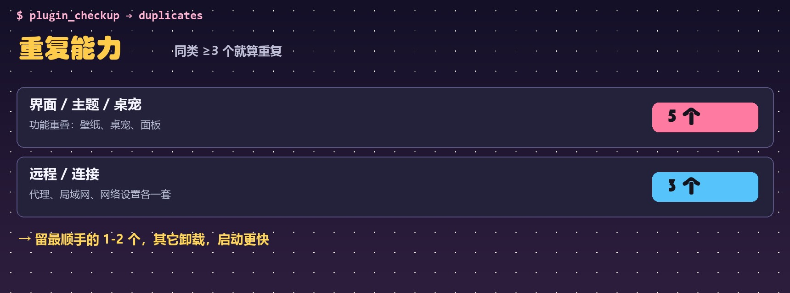
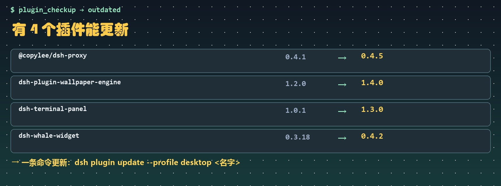

# dsh-plugin-checkup

 

DSH（DeepSeek Harness）插件：**插件体检**。装了一堆插件之后，你可能想知道——

- 我到底装了什么？在哪个 profile？是不是根本没启用？
- 有没有功能重复的插件（三个桌宠、两个记忆系统…）？
- 哪些有新版本？哪个最占体积？
- 每个插件到底「治什么病」？

这个插件把上面这些问题变成三个只读工具。**不改任何东西**，只扫描本地 profile。

## 工具

| 工具 | 作用 |
|---|---|
| `plugin_list(profile?)` | 列出已装插件（版本 / 描述 / 安装方式 / 是否在 bundles / 体积） |
| `plugin_checkup()` | 体检：按「治什么病」分类、重复能力、装了没启用、体积 top5、可更新版本 + 建议 |
| `plugin_why(name)` | 查单个插件：版本、来源、安装方式、在哪些 profile、是否启用、体积 |

## 分类维度（按名字/描述自动归类）

记忆/上下文 · 语音/字幕 · 界面/主题/桌宠 · 远程/连接 · 媒体/下载 · 插件管理/市场 · 安全/沙箱 · 会话/进度/任务 · 搜索/网络工具 · 模型/推理

## 截图 &amp; 示例输出





完整示例：[docs/example-output.json](docs/example-output.json)（本机真实 profile 体检）


## 示例输出

```
profiles: desktop, headless | 插件数: 11

=== 按「治什么病」分类 ===
界面 / 主题 / 桌宠（4）: dsh-whale-widget@0.3.18、dsh-plugin-whale-pet@0.2.9、dsh-plugin-wallpaper-engine@1.2.0、gal-view@…
媒体 / 下载（1）: dsh-bili-scroll@…
插件管理 / 市场（1）: dsh-plugin-checkup@0.1.0
...
=== 体检 ===
重复能力: 界面 / 主题 / 桌宠×4
建议:
 · 有 1 类能力装了 3 个以上（界面 / 主题 / 桌宠×4），考虑留最顺手的 1-2 个。
```

## 安装

```powershell
dsh plugin --profile desktop add link:C:\path\to\dsh-plugin-checkup
# 或 GitHub / npm
```

装完重启 DSH。

## 隐私

- 只读本地 `~/.dsh/profiles/**/package.json` 和插件包信息，不上传任何数据
- 查更新时只向 npm registry 请求插件名（公开信息），失败自动跳过

## 开发

```powershell
node test/plugin.test.mjs   # 单元测试（临时目录造数据，不联网）
node scripts/demo.mjs       # 真实 profile 演示
```

## License

MIT
